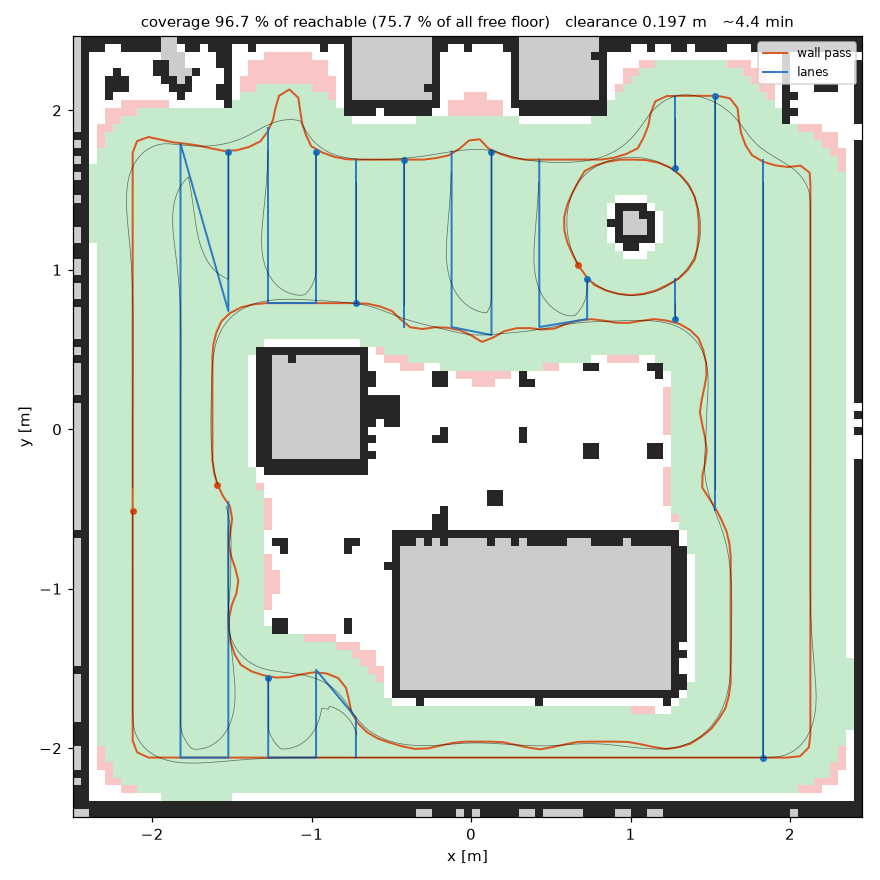

# vacuum_sim

ROS 2 **Jazzy** + Gazebo (gz-sim) simulation of a round robot vacuum: SLAM, Nav2, teleop,
bumpers, coverage cleaning with a run report, simulated dirt, and a vision model that finds
dirt on the floor and sends the robot back to it. Native Ubuntu 24.04, no Docker, no `kaiaai`
packages.

The point of the project is premium-vacuum features (SLAM, Nav2, coverage planning) on
budget-tier hardware. The part that is ours is the **verify-and-reclean loop**: after a clean
the robot looks at the floor with its camera, finds dirt still there, and goes back to it.

The robot model, world and Nav2 tuning derive from [OOMWOO](https://github.com/makerspet/oomwoo)
by Maker's Pet / KAIA.AI (Apache-2.0) — see [NOTICE](NOTICE).

> **Status: the simulation is finished.** Everything below runs end to end on this machine.
> The project pauses here and resumes on real hardware (STM32 + RPLidar) — see
> [Roadmap](#roadmap).

## Packages

| Package | Contents |
|---|---|
| `vacuum_description` | URDF xacro (body, wheels, LiDAR, ToF, side ranges, IMU, bumpers, floor camera, gz plugins), `gz_bridge.yaml`, RViz configs |
| `vacuum_gazebo` | `worlds/living_room.world`, models, `maps/`, `launch/sim.launch.py`, dirt scripts (`dirt_world`, `dirt_cleaner`, `dirt_labels`, `dirt_dataset`) |
| `vacuum_bringup` | `vacuum.launch.py` (everything), `navigation.launch.py` (SLAM or AMCL + Nav2), `config/navigation.yaml`, `save_map.sh` |
| `vacuum_coverage` | coverage mission, meter, re-clean pass, run report, offline planner/preview |
| `vacuum_vision` | dirt detector node (YOLO11n via ONNX Runtime), spot tracker, camera geometry |
| `vacuum_teleop` | gamepad teleop (`joy` + `teleop_twist_joy` → `/cmd_vel`) |
| `vacuum_gui` | PySide6 control panel: launch manager, map/camera/health views, missions, experiments |
| `tools/dirt_dataset` | dataset batch runner, train/val/test packager, Colab training notebook |
| `models/dirt_detector` | trained detector (`.pt` + `.onnx`) |

## Quickstart (fresh clone)

```bash
git clone https://github.com/Aditya-as-rgb/RoboVAC.git vacuum_sim
cd vacuum_sim
./bootstrap.sh             # rosdep install + Python extras + colcon build
./bootstrap.sh --desktop   # same, and add the control panel to the app menu
source /opt/ros/jazzy/setup.zsh && source install/setup.zsh
ros2 launch vacuum_bringup vacuum.launch.py      # sim + Nav2 + RViz + coverage
```

`bootstrap.sh` is idempotent: it sources `/opt/ros/<distro>`, runs `rosdep install` over
the declared dependencies, installs the three Python extras the ROS side needs
(`onnxruntime`, `numpy<2`, `PySide6`) into the system interpreter only if they are missing,
then builds. It does **not** install ROS itself — with no `/opt/ros/jazzy` it points at the
install page and stops. Flags: `--desktop`, `--no-build`, `--no-pip`;
`ROS_DISTRO=humble ./bootstrap.sh` for another distro.

Tested on Ubuntu 24.04 + ROS 2 Jazzy, native (no Docker). The directory name does not
matter — nothing hardcodes it. Below, `<ws>` means the clone's root, i.e. the folder that
contains `src/`.

## Install (manual, if you skip bootstrap.sh)

```bash
sudo apt install -y ros-jazzy-desktop ros-jazzy-ros-gz ros-jazzy-navigation2 \
  ros-jazzy-nav2-bringup ros-jazzy-slam-toolbox ros-jazzy-teleop-twist-keyboard \
  ros-jazzy-joy ros-jazzy-teleop-twist-joy ros-jazzy-xacro ros-jazzy-robot-state-publisher \
  python3-colcon-common-extensions python3-rosdep python3-numpy python3-yaml \
  python3-matplotlib python3-pil python3-pytest

# system Python only (the one rclpy uses): detector runtime + control panel
/usr/bin/python3 -m pip install --user --break-system-packages onnxruntime "numpy<2" PySide6
```

Ultralytics is only needed to train (in Colab, `tools/dirt_dataset/train_dirt_yolo.ipynb`),
never on the robot.

## Build (manual)

```bash
cd <ws>                               # the folder containing src/
source /opt/ros/jazzy/setup.zsh       # bash users: setup.bash, here and below
rosdep install --from-paths src --ignore-src -r -y
colcon build --symlink-install
source install/setup.zsh
```

## Command cheatsheet

Everything assumes `source /opt/ros/jazzy/setup.zsh && source install/setup.zsh` in the
current shell. `scripts/` paths are relative to the workspace root.

### Run the simulation

| Mode | Command |
|---|---|
| Full stack: sim + AMCL + Nav2 + RViz + gamepad + coverage | `ros2 launch vacuum_bringup vacuum.launch.py` |
| ...and clean immediately | `ros2 launch vacuum_bringup vacuum.launch.py autostart:=true` |
| SLAM: map while driving, no saved map | `ros2 launch vacuum_bringup vacuum.launch.py slam:=true` |
| Saved map | `ros2 launch vacuum_bringup vacuum.launch.py map:=<ws>/maps/living_room.yaml` |
| Headless (no Gazebo/RViz windows) | `ros2 launch vacuum_bringup vacuum.launch.py headless:=true rviz:=false` |
| Keyboard instead of gamepad | `ros2 launch vacuum_bringup vacuum.launch.py teleop:=none` |
| No coverage/meter (pure nav) | `ros2 launch vacuum_bringup vacuum.launch.py coverage:=false meter:=false` |
| Dirt on the floor | `ros2 launch vacuum_bringup vacuum.launch.py dirt:=15 dirt_seed:=3 autostart:=true` |
| Vision-guided re-clean | `ros2 launch vacuum_bringup vacuum.launch.py dirt:=12 dirt_seed:=3 reclean_source:=vision autostart:=true` |
| Detector only running | `ros2 launch vacuum_bringup vacuum.launch.py detector:=true dirt:=12 dirt_clean:=false` |

### Step by step (one terminal each, source in every one)

| Step | Command |
|---|---|
| Gazebo + robot | `ros2 launch vacuum_gazebo sim.launch.py` |
| SLAM + Nav2 + RViz | `ros2 launch vacuum_bringup navigation.launch.py` |
| ...on a saved map instead | `ros2 launch vacuum_bringup navigation.launch.py slam:=false map:=<ws>/maps/living_room.yaml` |
| Drive (keyboard) | `ros2 run teleop_twist_keyboard teleop_twist_keyboard` |
| Drive (gamepad) | `ros2 launch vacuum_teleop teleop_joy.launch.py` |
| Coverage mission | `ros2 launch vacuum_coverage coverage.launch.py` (+ `autostart:=true`) |
| Detector | `ros2 launch vacuum_vision detector.launch.py` |
| Save the map | `ros2 run vacuum_bringup save_map.sh living_room` → `maps/living_room.{yaml,pgm}` |

### Mission services (when not autostarted)

```bash
ros2 service call /coverage_mission/plan  std_srvs/srv/Trigger   # draw the plan only
ros2 service call /coverage_mission/start std_srvs/srv/Trigger
ros2 service call /coverage_mission/stop  std_srvs/srv/Trigger
ros2 service call /coverage_meter/reset   std_srvs/srv/Trigger
```

### Control panel

| Task | Command |
|---|---|
| Start the panel | `ros2 run vacuum_gui vacuum_gui` |
| ...as a launch file | `ros2 launch vacuum_gui gui.launch.py` (`xcb:=true`, `theme:=nord`) |
| Install desktop app + `vacuum_gui` command | `ros2 run vacuum_gui vacuum_gui_install_desktop` |
| Remove it | `ros2 run vacuum_gui vacuum_gui_install_desktop --uninstall` |

### Datasets, model, tests

```bash
tools/dirt_dataset/collect_dataset.sh 20                    # batch of labelled runs
python3 tools/dirt_dataset/package_dataset.py ~/vacuum_runs/dataset \
        ~/vacuum_runs/dirt_yolo --classes kind --zip        # split + zip for Colab

python3 -m pytest src/vacuum_coverage/test src/vacuum_gazebo/test \
                  src/vacuum_vision/test src/vacuum_gui/test -q          # 242 tests, no ROS
# ...with /usr/bin/python3 if a venv shadows python3 on PATH; the GUI tests pick an
# offscreen Qt platform by themselves, so no display is needed.
python3 src/vacuum_gazebo/scripts/dirt_world.py --help                  # preview dirt layout
cd src/vacuum_coverage && python3 -m vacuum_coverage.preview \
    --map ../vacuum_gazebo/maps/living_room.yaml --out plan.png --simulate
```

## Launch modes reference

**`vacuum_bringup/vacuum.launch.py`** — the whole stack in one `ros2 launch` tree.

| Argument | Default | Meaning |
|---|---|---|
| `slam` | `False` | `True` = SLAM instead of AMCL on a saved map |
| `map` | `<ws>/maps/living_room.yaml` | map for AMCL, the meter and the planner; falls back to the copy inside `vacuum_gazebo/maps` |
| `world`, `x_pose`, `y_pose` | `living_room.world`, `-2.0`, `-0.5` | Gazebo world and spawn pose |
| `odom_source` | `ground_truth` | or `robot_wheels` (drifts, for realism) |
| `headless`, `rviz` | `false`, `true` | windows on/off |
| `teleop` | `joy` | `none` = no gamepad process |
| `coverage`, `meter`, `autostart` | `true`, `true`, `false` | mission, meter, clean without a service call |
| `reclean_source` | `map` | `map` (from coverage gaps) or `vision` (`/dirt/detections`) |
| `cameras`, `detector` | `false`, `false` | floor camera; detector (`detector:=true` turns the camera on) |
| `dirt`, `dirt_seed`, `dirt_scale`, `dirt_stubborn`, `dirt_brush`, `dirt_clean`, `dirt_randomize` | `0`, `1`, `1.0`, `0.15`, `0.20`, `true`, `false` | dirt layout (below) |
| `collect_dataset`, `dataset_dir`, `dataset_max_s` | `false`, `~/vacuum_runs/dataset`, `3600` | labelled-frame recorder |
| `nav_delay` | `8.0` | seconds Gazebo gets before Nav2 starts |
| `qt_platform` | `xcb` | Gazebo GUI through XWayland (Hyprland/Wayland) |

**`vacuum_gazebo/sim.launch.py`** — Gazebo + bridge + robot only.
`headless`, `software_gl`, `odom_source`, `x_pose`/`y_pose`, `world`, `description_pkg`,
sensor switches `enable_lidar`/`enable_ranges`/`enable_tof`/`enable_cameras`/`enable_imu`,
plus the `dirt_*` arguments. Use `software_gl:=true` if the Gazebo window dies with an
OGRE/EGL error.

**`vacuum_bringup/navigation.launch.py`** — Nav2 + RViz on an existing sim:
`slam` (default `True`), `map`, `params_file`, `rviz`, `rviz_config`, `x_pose`/`y_pose`
(AMCL seed, must match the spawn pose), `use_sim_time`.

**`vacuum_coverage/coverage.launch.py`** — mission + meter only: `autostart`, `meter`,
`reclean_source`, `params_file`.

**`vacuum_vision/detector.launch.py`** — detector only: `model` (path; default searches
`models/dirt_detector/`), `params_file`.

**`vacuum_teleop/teleop_joy.launch.py`** — `joy_dev` (default 0), `joy_vel` (default
`cmd_vel`), `config`. Hold **LB** (deadman), left stick to drive, **RB** for turbo;
0.30 m/s / 1.20 rad/s by default. If the pad is not found:
`ros2 run joy joy_enumerate_devices` then pass `joy_dev:=1`.

**`vacuum_gui/gui.launch.py`** — the panel only (`xcb`, `theme`, `no_ros`). It starts the
simulation itself, so there is never a second Gazebo.

## Coverage and the re-clean loop

`vacuum_coverage` plans on the saved map's occupancy grid and drives the plan with Nav2, so
use it with AMCL (`slam:=false`), not while the map is still moving.



1. **Wall pass** — grow obstacles by robot radius + margin, take the boundary loops (walls
   and each piece of furniture), smooth them, send each as a `FollowPath` goal.
2. **Lane sweep** — parallel lanes `lane_spacing` apart through the remainder, cut at
   furniture, nearest-first; hops are `NavigateToPose`, aborted pieces are retried then
   skipped after `max_retries`.
3. **Self-check** — the plan is run through an offline model of the Nav2 controller before
   the robot moves; `wall_margin` is widened until the simulated clearance is at least
   `robot_radius + safety` (0.197 m on the living-room map).
4. **Re-clean pass** — compare cleaned cells with reachable floor, pick the fewest spots that
   cover the gaps (greedy set cover), clean them, repeat up to `reclean_passes`. With
   `reclean_source:=vision` the spots come from the camera instead of the coverage tracker.

On the living-room map the planner reports **96.7 % of reachable floor** and **75.7 % of all
free floor** — the difference is the rug under the coffee table, where the robot does not fit.
`/coverage/percent` is the first number, `/coverage/percent_free` the second.

Every mission writes `~/vacuum_runs/run_<timestamp>/` with `summary.json` (time, distance,
coverage before/after per pass, pieces done/skipped, re-clean spots, `unseen_m2`),
`coverage.csv` (curve over time), `pieces.csv` (one row per wall loop / lane / spot) and
`report.png`. Compare runs by keeping the folders.

Tuning lives in `src/vacuum_coverage/config/coverage.yaml`. Keep
`pursuit_lookahead`/`pursuit_speed` equal to `CoveragePath` in `navigation.yaml`, or the
offline safety check stops describing the real controller.

## Dirt and the dirt detector

`dirt:=N` scatters N visual-only patches (no collision) on reachable floor, placed from the
map; the same `dirt_seed` gives the same layout. Four kinds: crumbs, dust, spill, hair.
Ground truth goes to `~/vacuum_runs/dirt/`, the remainder is published on `/dirt/remaining`
and drawn in RViz (`/dirt/markers`).

The floor camera is one RGB/front camera (640×480, ~7 cm above the floor, 38° down). Gazebo
knows where each patch is and TF gives the camera pose, so training frames are labelled
automatically — unreliable frames (edge-cut, occluded, tiny) are dropped instead of
mislabelled.

Current model (`models/dirt_detector/dirt_yolo11n.onnx`): 10 episodes, 3040/1062/1296
train/val/test images split by episode. Held-out test: **mAP50 0.68** (crumbs 0.74, dust
0.54, spill 0.84, hair 0.60); dust recall is low (0.29). **Simulation numbers only** — the
model has not been tested on real floor photos, and that is the number that matters next.

The detector turns sightings into map spots (`SpotTracker`: merges within `merge_radius`,
confirms after `min_hits`, drops after `clear_misses` frames that see nothing), published on
`/dirt/detections` (JSON, latched), `/dirt/detected_markers` and `/dirt/debug_image`.
Parameters in `src/vacuum_vision/config/detector.yaml`; tune them live with
`ros2 param set /dirt_detector conf 0.35`.

Blind vs vision comparison — same seeds, one flag apart:

```bash
ros2 launch vacuum_bringup vacuum.launch.py dirt:=12 dirt_seed:=3 reclean_source:=map    autostart:=true
ros2 launch vacuum_bringup vacuum.launch.py dirt:=12 dirt_seed:=3 reclean_source:=vision autostart:=true
```

## Control panel (`vacuum_gui`)

One PySide6 window that starts and stops the stack, draws the map, camera, LiDAR, plans,
dirt and health from ROS topics, and drives the robot. Gazebo and RViz are **not** embedded,
so the sim can run headless and RViz is optional; the buttons for the real windows are still
there.

### Build and run

```bash
/usr/bin/python3 -m pip install --user --break-system-packages PySide6   # once
cd ~/vacuum_sim && source /opt/ros/jazzy/setup.zsh
colcon build --symlink-install --packages-select vacuum_gui
source install/setup.zsh

ros2 run vacuum_gui vacuum_gui                  # the panel
ros2 launch vacuum_gui gui.launch.py            # same, as a launch file
ros2 run vacuum_gui vacuum_gui --xcb --theme nord --no-ros   # options at launch
```

`ros2 run` is the supported way to start it: an ament_python package's entry points land in
`install/vacuum_gui/lib/vacuum_gui/`, which is not on `PATH`. Panel `--xcb` forces Qt through
XWayland if the native Wayland plugin misbehaves; `--theme` picks one of System, Graphite,
Midnight, Nord, Dracula, Mocha, High contrast, Daylight, Solarized light; `--no-ros` opens
the UI without a ROS backend (layout work); `--reset-layout` restores the docks.

### How it becomes a desktop application

```bash
ros2 run vacuum_gui vacuum_gui_install_desktop              # install
ros2 run vacuum_gui vacuum_gui_install_desktop --uninstall  # remove
ros2 run vacuum_gui vacuum_gui_install_desktop --workspace /path/to/ws
```

No sudo, and nothing is written into the repository. It creates four things under `~/.local`:

| Path | What it is |
|---|---|
| `~/.local/bin/vacuum_gui` | shell wrapper: sources `/opt/ros/<distro>/setup.bash` and `<ws>/install/setup.bash`, puts `/usr/bin:/bin` first on `PATH` (so no venv python shadows `rclpy`), then `exec ros2 run vacuum_gui vacuum_gui "$@"` |
| `~/.local/bin/vacuum_gui_launch` | symlink alias to the wrapper |
| `~/.local/share/applications/vacuum_gui.desktop` | menu entry (*RoboVAC Control Panel*, `Exec` = absolute wrapper path, `StartupWMClass=vacuum_gui`, categories Robotics/Science/Utility) |
| `~/.local/share/icons/hicolor/scalable/apps/vacuum_gui.svg` | icon from `src/vacuum_gui/assets/` |

Why the wrapper: the menu has no shell profile, so ROS and the workspace must be sourced
inside the launcher, and the desktop entry needs an absolute `Exec`. `colcon` also installs
`vacuum_gui.desktop` into `install/vacuum_gui/share/applications`, but the menu only reads
`~/.local/share/applications` and `/usr/share/applications` — hence the copy with a resolved
`Exec` and icon. After installing, the bare command `vacuum_gui` works in a login shell and
the panel appears in the app launcher (on Hyprland: `hyprctl dispatch exec vacuum_gui`, or
`gtk-launch vacuum_gui` to test the menu entry). Log out and back in if the entry does not
show up immediately.

### Panels

| Panel | What it does |
|---|---|
| **Stack** | every launch option with defaults remembered, the exact command line (copy button), pre-flight checks with fix hints, `Kill leftovers`; launch-time options grey out while running and raise `restart needed` |
| **Map** | `/map`, `/coverage_map`, `/scan`, global/local plans, plan markers, detected and ground-truth dirt, AMCL particles, costmaps, trail; click = Nav2 goal / 2D pose estimate / inspect dirt |
| **Camera** | `/camera/image` and `/dirt/debug_image` with real frame rates and a `no signal` state |
| **Health** | a light per node, per key topic and for the TF chain; click a red light for the reason and the fix |
| **Mission** | plan, start, stop, reset meter, coverage bar, per-piece list, re-clean switch, map save/load |
| **Robot** | hold-to-drive pad under the Nav2 limits, gamepad indicator from `/joy`, emergency stop (cancels goal and mission, publishes zero `/cmd_vel` at 10 Hz until released) |
| **Dataset** | start/stop the recorder, count episodes/images, run the packager |
| **Runs** | browse `~/vacuum_runs/run_*/`, read `summary.json`, compare two runs, plot `coverage.csv` |
| **Experiments** | seeds × {no re-clean, map, vision}, headless, one at a time, results table + `results.csv` |
| **Tools** | live detector parameters, screenshots/GIFs, rosbag toggle |
| **Log / Help** | one tab per process plus `All`, filter and save; panel guide and shortcuts (`F1`) |

`vacuum.launch.py` fixes world, map, camera, dirt layout, odometry and `nav_delay`;
gamepad, detector, mission+meter, recording and RViz are separate processes the panel owns,
which is why its preview shows `teleop:=none coverage:=false meter:=false detector:=false
collect_dataset:=false rviz:=false`. rclpy spins in its own `MultiThreadedExecutor` thread;
GUI commands go back through a queue, so no ROS call ever runs on the Qt thread.

Settings/presets/layout: `~/.config/vacuum_gui/`. Runs, datasets, bags, screenshots:
`~/vacuum_runs/`. Tests: `cd src/vacuum_gui && python3 -m pytest test -q` (81, no ROS, no
display).

## Interface contract

Keep these and Nav2, SLAM and the bridge keep working when the URDF is replaced:

| Item | Value |
|---|---|
| TF | `map → odom → base_footprint → base_link → base_scan` (+ wheels, sensors, `camera_link → camera_optical_frame`) |
| Topics out | `/scan`, `/odom`, `/imu`, `/tf`, `/joint_states`, `/clock`, `/bumper_left/contact`, `/bumper_right/contact`, `/camera/image` + `/camera/camera_info` |
| Topic in | `/cmd_vel` (`geometry_msgs/Twist`), diff-drive plugin |
| gz names | model `vacuum`, world `default` (referenced by the bridge and the dirt removal service) |
| Footprint | Nav2 radius tuned for ~0.349 m diameter; update it when the body changes |
| Camera | REP-103 optical frame (z forward, x right, y down); labels read pose from TF and intrinsics from `camera_info` |

Bumpers break silently: contact sensors reference post-URDF-to-SDF collision names, the
bridge uses the scoped gz topic, and the world must load `gz-sim-contact-system`.

To swap in your own robot: copy `vacuum_description`, edit `urdf/params.xacro` and
`robot.urdf.xacro`, launch with `description_pkg:=myvac_description`, regenerate collision
names (`xacro urdf/robot.urdf.xacro | gz sdf -p /dev/stdin | grep 'collision name'`) and
retune the Nav2 footprint/inflation in `navigation.yaml`.

## Troubleshooting

- **Gazebo headless crashes (exit 139, EGL / `driCreateNewScreen3`)** — unset
  `MESA_LOADER_DRIVER_OVERRIDE` (and other `LIBGL_*`/`GALLIUM_DRIVER` vars). Headless uses
  software rendering only when `/dev/dri` is missing; `software_gl:=true` forces it.
- **Nodes die on import (`numpy`/`rclpy` not found)** — a venv is shadowing
  `/usr/bin/python3`: `PATH=/usr/bin:/bin:$PATH ros2 launch ...`.
- **Second `/clock`, AMCL "jump back in time"** — a `ros_gz_bridge` leaked from an earlier
  run. Stop the stack cleanly; in the panel use `Kill leftovers`, otherwise
  `pkill -f parameter_bridge`.
- **AMCL cannot localise** — `initial_pose` in `navigation.yaml` must match `x_pose`/`y_pose`,
  or set it with "2D Pose Estimate".
- **`source install/setup.bash` fails under `set -u`** — wrap it: `set +u; source ...; set -u`.
- **Wayland** — Gazebo/RViz go through XWayland (`qt_platform:=xcb`, the default); the panel
  has `--xcb` as a fallback.
- **`vacuum_gui` exits with "PySide6 is not installed"** — install it into the interpreter
  that has `rclpy` (`/usr/bin/python3 -m pip install --user --break-system-packages PySide6`);
  a venv's pip installs it where the ROS nodes cannot see it.
- **`ros2 launch ... --show-args` shows a map path you did not expect** — the `map` default is
  `<ws>/maps/living_room.yaml` when that file exists, otherwise `vacuum_gazebo/maps`. Delete
  or pass `map:=` if the saved map is stale.

## Roadmap

Done in simulation; the list below is what is left, mostly for hardware.

1. **Real floor photos for the detector — next.** Sim-only scores decide nothing on a real
   carpet.
2. **Controlled blind-vs-vision experiment.** Both sources are wired
   (`reclean_source:=map|vision`) and both write their source, detections and `unseen_m2`
   into `summary.json`; the seeded batch (three ways × N seeds) still has to be run.
3. **Stop on signal loss.** gz DiffDrive keeps the last `/cmd_vel`; plan is `twist_mux` with
   the joystick on a high-priority input, Nav2 low, ~0.5 s timeout.
4. **More worlds.** A room generator so planner and detector are not tuned to one living room.
5. **Own robot description.** Replace `vacuum_description`, retune footprint and inflation,
   then move to the STM32 + RPLidar hardware backend behind `vacuum_gui/backend.py`.

## Files the code writes

Nothing is written into the repository at runtime except maps, which are meant to be kept.

| Path | Contents |
|---|---|
| `<ws>/maps/` | `save_map.sh` output; the launch files and the panel read here first |
| `~/vacuum_runs/` | run reports, dirt ground truth, datasets, bags, screenshots, experiments |
| `~/.config/vacuum_gui/` | panel settings, presets, dock layout |
| `~/.local/bin/`, `~/.local/share/applications/` | desktop launcher written by `vacuum_gui_install_desktop` |
